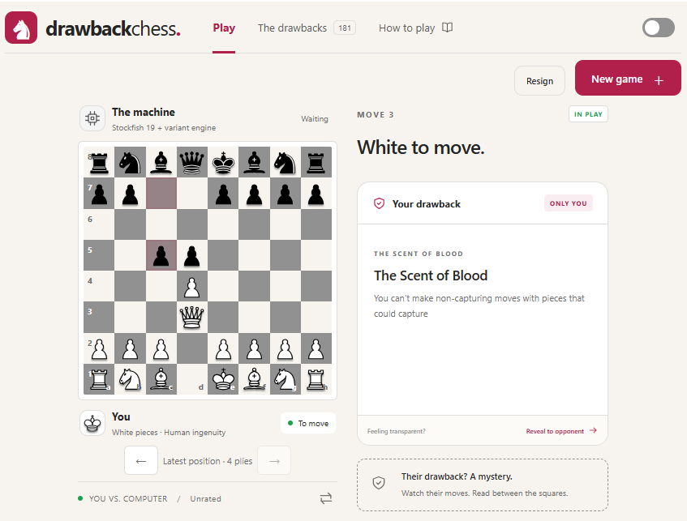

# Drawback Chess

Browser-based chess with a secret disadvantage, inspired by
[Drawback Chess](https://www.drawbackchess.com/). Each player gets a hidden
drawback that changes how they can play. You know yours, but discovering your
opponent's limitations is part of the strategy. Reveal your drawback whenever
you want.

Play against the computer or a friend on the same device, with **181 drawbacks**
to choose from or assign randomly. The game enforces restrictions and highlights
legal moves when you select a piece.

There is **no check or checkmate**: capture the opposing king or leave your
opponent with no legal moves to win. Threefold repetition ends in a draw.



## A few drawbacks

| Drawback | The catch |
|---|---|
| Castle Doctrine | Losing a rook loses you the game. |
| Centralized Command | You can capture only if you moved your king on one of your previous three turns. |
| Even Keeled | You can capture only on your even-numbered turns. |
| Alternator | Alternate between pawn and non-pawn moves. |
| Secret Garden | Protect two secret squares: you cannot land on them, and an opponent landing there loses you the game. |
| Fog of War | Only your pieces and the squares they can reach are visible. |

See [all 181 drawbacks](DRAWBACKS.md) for the full list.

## Install and run

Requires **Node.js 22.12+** (or a newer supported release).

```powershell
git clone https://github.com/neaorin/drawback-chess.git
cd drawback-chess
npm install
npm run dev
```

Open the localhost URL printed in your terminal.

To build and run the production version:

```powershell
npm run build
npm run preview
```

See the [technical documentation](TECHNICAL.md) for detailed rules, implementation,
AI behavior, testing, licensing, and deployment instructions.
